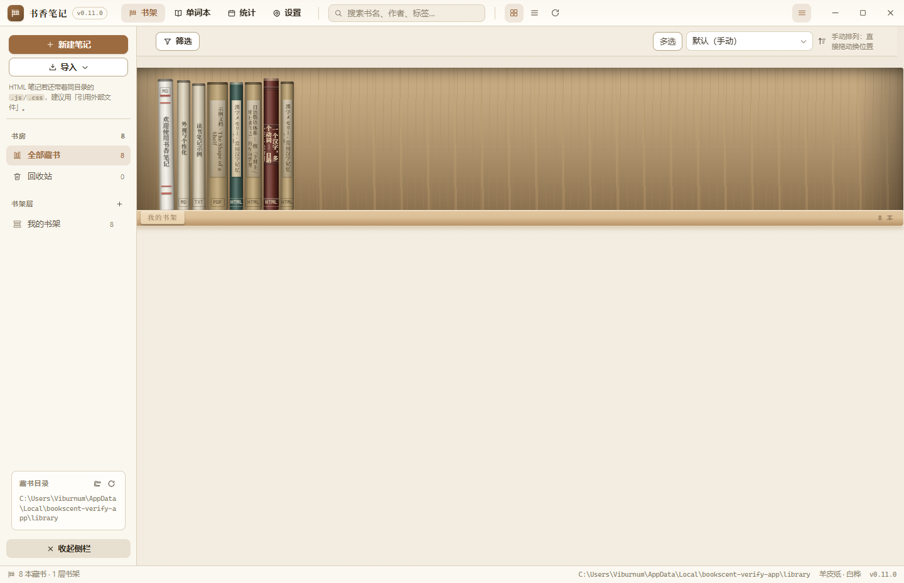

# 书香笔记 · Bookscent

> 一座属于你自己的书房。书架上的每一本书，都是你读过或写下的一页。

Windows 桌面笔记与文档阅读应用，**版本 0.11.0**。以仿真实体书架为主界面：书脊的厚薄由页数决定，封面与书脊都能换成你自己的图片；Markdown / 纯文本可以直接在里面写，PDF 与 EPUB 可以直接在里面读、画、批注、抽图。

<!--
想加一张截图：把图片放到 docs/ 下（例如 docs/shelf.png），再把下面这行取消注释。
截图可以用 `pnpm shots` 自动生成，也可以直接对窗口截屏。

-->

---

## 一、功能总览

### 1. 文档格式

| 格式 | 打开方式 | 说明 |
| --- | --- | --- |
| `.md` `.markdown` `.mdown` `.mkd` | 内置编辑器 | 左侧写作、右侧实时预览，可切换单栏 / 分栏 / 纯预览 |
| `.txt` `.text` `.log` | 内置编辑器 | 纯文本编辑，自动识别 UTF-8 / GB18030 / Big5 / UTF-16 |
| `.pdf` | 内置阅读器 | 书签、绘图批注、内嵌图片提取、页面导出、批注导出回 PDF |
| `.docx` | 只读渲染 | mammoth 转 HTML 排版预览，可一键交给 Word |
| `.doc` | 只读文本 | 直接抽取正文，可一键交给 Word |
| `.rtf` `.html` `.epub` | 只读 | 文本 / 网页渲染预览 |
| `.png` `.jpg` `.webp` `.gif` `.bmp` `.avif` | 图片查看 | 在纸感背景上查看 |

### 2. 仿真实体书架

- **书脊厚度由页数决定**：PDF 读真实页数，DOCX 读文档自带页数，Markdown / 纯文本按字数估算，估算结果显示为「约 N 页」。
- **书脊面两种形态**：默认渲染「底色 + 装饰 + 书名 + 格式标记」；一旦插入书脊图片，就直接用图片铺满整条书脊。
- **书籍朝向三选一**：书脊朝外（默认）／封面朝外（像书店的封面陈列）／自定义角度（0°–90° 之间的任意角度，用 3D 透视把书脊和封面同时转出来）。
- **高度完全统一或自然错落**：完全统一 / 轻微错落 / 明显错落三档。
- **书架层排布两种**：分层显示（每层独占一段）或**连续书柜**——每层变成一「格」，各格横向并排、上下相连成一面整墙；单格最大宽度可调，装不下就自动换行。
- **筛选与排序**：顶部工具条可按格式、阅读状态、标签、最低评分筛选，可与搜索叠加；排序支持默认（手动）／最近打开／加入时间／书名／作者／页数／评分／格式，并可正反序。
- **拖拽排序**：默认排序下直接拖动即可；在其他排序下拖动，会先弹出确认窗——因为那等于把当前顺序固化成新的默认顺序，会覆盖原来的手动排列。
- **打开动画**：点开一本书时会「抽出书架 → 飞到眼前转正 → 封面翻开 → 化入阅读界面」，可在设置里关掉或改成简洁版。
- **抽出预览**：鼠标悬停时书本会从架上抽出并略微旋转，露出封面。
- **书架层**：可以建多层书架，双击层名重命名，右键任意一本书即可「移动到书架层」。
- **书脊样式列表**：内置六套样式（古典皮革、布纹精装、现代扁平、竹节烫金、平装纸书、藏书票），可以增删改、启用停用，并选择分配方式——全部统一／按书名稳定分配／沿书架依次轮换。单本书的单独覆盖始终优先。

### 3. 设置页

标题栏的「设置」里有七个分页：**通用 / 外观 / 书脊样式 / 书架与排序 / 阅读与编辑 / 文件与数据 / 关于**。原来的「外观」已经并进设置，作为其中一个分页，内含应用主题、书架主题与书籍样式三段。

「文件与数据」里可以改**藏书目录**，以及**书籍外观图片的数据目录**：封面与书脊贴图都以文件形式存放在那里，配置里只记一个文件名；还能一键把早期版本遗留在索引里的 base64 内联图片搬到数据目录，索引会明显变小。

### 4. Markdown / 纯文本编辑

- CodeMirror 6 编辑器，跟随主题自动切换明暗配色。
- 工具栏覆盖加粗、斜体、删除线、H1–H3、无序/有序列表、引用、行内代码、代码块、链接、表格、分割线、待办清单。
- `Ctrl+S` 保存，开启自动保存后停止输入即写盘；显示脏标记与「已保存 · 时间」。
- 字数 / 行数 / 预计阅读时长状态栏；Markdown 大纲可点击跳转。
- 外部程序改了文件时，窗口重新获得焦点会检测到并提示重新载入。

### 5. PDF 阅读器

- 连续滚动 / 单页两种模式，缩放 10%–600%，适应宽度、适应页面、旋转。
- 左侧面板：缩略图、文档目录（PDF 自带大纲）、书签（可命名、跳转、删除）。
- 绘图批注：画笔、荧光笔、下划线、文字批注、橡皮擦，配合撤销、颜色与线宽，坐标按页面归一化存储，缩放旋转都不跑位。
- 全文搜索，命中页码与位置高亮。
- **图片提取**：既可以把页面按 1×–4× 渲染导出成 PNG / JPEG，也可以遍历 PDF 内嵌图像对象按原始分辨率抽取。
- **导出批注 PDF**：把画过的内容用 pdf-lib 烧进一份新的 PDF。
- 阅读进度（页码 / 滚动位置 / 缩放 / 旋转）自动记忆。

### 6. HTML 笔记（dsh 等工具生成的自包含页面）

DSH 这类工具生成的 HTML 笔记是**自包含的交互式页面**：内联 CSS/JS，常常还引用同目录
（或 `lib/` 子目录）下的 `.js` / `.css`。因此它们**不是**"净化后塞进应用 DOM"来渲染的，
而是以独立来源 `note://` **整页加载到 iframe**：

- 相对资源按原路径解析，样式与脚本按原样生效，页面里的筛选、标签页、进度都能用；
- 每本书一个 host（`note://b<bookid>/…`），与应用的 `app://bundle` 不同源，
  笔记脚本碰不到 `window.bookscent`，也读不到别的书；
- **只能访问这本书自己所在目录及其子目录**，其余一律 403；
- 笔记里的 `http(s)` 链接不会把笔记导航走，而是交给系统浏览器打开。

阅读器顶部有一条工具栏：资源体检结果、缩放、重新载入、打开所在文件夹、用浏览器打开。

几个细节：

| 行为 | 说明 |
| --- | --- |
| 书名 | 优先用文档自己的 `<title>`；`index.html` 这类外壳会退回到所在文件夹名 |
| 页数 | 先整块剥掉 `<script>`/`<style>`/注释再计字数，否则一个演示文稿外壳会被算成几百页 |
| 资源体检 | 只统计 `src=` 与 `<link href=`；`<a href="cat">` 这种页内锚点不会被误报成缺失文件 |
| 缺失资源 | 工具栏会显示缺失清单，并提示改用「引用外部文件」 |
| 断链 | 缺了 `#` 的页内跳转（`href="cat"`）会礼貌地退回笔记本身，而不是停在空白页 |
| 导入建议 | 笔记在同级还带着 `.js/.css` 时，**优先用「引用外部文件（不复制）」**；用复制也会把同级资源一并带过来，但 `../` 之外的引用无法保真 |

`scripts/verify-html-notes.mjs` 会在真实打包后的应用里导入几篇 DSH 笔记、
逐篇打开、检查资源与书名页数，最后把测试记录删掉：

```powershell
node scripts/deploy-local.mjs
node scripts/verify-html-notes.mjs
```

`scripts/verify-app.mjs` 是全量逐项验证：在真实打包后的应用里跑，
逐项检查版本号、书脊居中、三种朝向、高度模式、筛选、拖拽排序与确认弹窗、
连续书柜、设置分页、书脊样式列表、侧栏入口、打开动画，并留下截图。
它用独立的 userData，不会碰你自己的书架：

```powershell
pnpm verify:app
```

### 7. 外观个性化

- **应用主题** 10 套：羊皮纸、胡桃木书房、宣纸墨、墨夜、青瓷、酒红皮革、白桦、黑檀、竹简、石室。
- **书架主题** 独立选择：木纹、纸纹、麻布、石纹等材质，木板、内壁、木色全部可换。
- **书籍样式** 6 套预设（古典皮革、布纹精装、现代扁平、竹节烫金、平装纸书、藏书票），并可逐项微调。
- **书脊样式列表**：预设与自制样式放在同一张列表里管理，配合分配方式让一柜书自然错落。
- **自定义主题**：在任意预设之上覆盖单个颜色令牌，存成自己的主题。
- 全局书籍样式之外，每本书都可以有自己的一套外观，包括换成自己的封面图与书脊贴图。
- 设置可导出 / 导入 JSON，换电脑时书房跟着走。

### 8. 版本

`0.10.1`

**0.11.0 更新**

- **单词本**（侧栏，与「全部藏书」并列）：
  - 翻译的解析末尾现在会附一份**结构化词汇表**（原词 / 读音 / 释义），
    在翻译栏里按行列出，每条带「加入」，也能「全部加入」—— 解析与单词本之间不用手抄；
  - 词条**按语种分开记**：日 / 英 / 中 / 韩 / 法 / 德… 按字符集判断，
    有假名读音时优先判为日文（单个汉字分不出中日，靠读音定）；
  - 页面顶部是语种标签（带条数），可按时间 / 字母 / 出处排序、搜索、编辑释义与备注、单条删除；
  - 词条存在单独的 `vocabulary.json`；**同一个词重复加入会合并**（补全空释义、保留原出处）而不是占两条。
- 版本号 0.11.0。

**0.10.2 更新**

- **文本朗读**（阅读器工具栏上的「朗读」，底部出现一条朗读栏）：
  - **在线语音走 Edge 那一套**：一次拉回 **322 个语音、142 种语言**（中文 14 个，晓晓 / 云希 / 云扬…），
    按语言分组选，语速与音调可调；音频由主进程合成（避开跨域，也把鉴权细节留在主进程）；
  - **系统语音**（离线）：交给 Web Speech API，语种取决于系统里装了什么；
  - 朗读按**段落**切分：上一段 / 下一段、暂停 / 继续都立刻有反应，面板里显示正在读的那一段；
  - 勾上「连读下一节」会读完一节自动翻页接着读。
- 这一轮又按反馈调了几处：
  - **朗读栏改成横向底栏**（之前它被放进横向 flex 容器里，成了一条竖着的右侧宽栏，段落一长整页都被占住）；
  - **再点「朗读」不会重头读**：已经在读/暂停时点开只是展开控件，只有"还没有内容"才从这一节开头起；
  - **段间不再等几秒**：这一段开始播时就把下一段合成好放缓存（缓存键带语音/语速/音调），轮到时直接取；
  - **逐句高亮**：读完按句切分，正在读的那句用 CSS Custom Highlight 标出来（不动 DOM，不干扰自己的标注）；
  - **新增有道智云、腾讯云语音合成**（有道走它的 ttsapi + v3 签名取 speakUrl；腾讯走 TextToVoice + TC3-HMAC-SHA256 签名）；
  - 在线语音的默认实现换成 **Python 的 edge-tts 子进程**（Node 内置 WebSocket 不读代理，需要代理的机器上连不上），内置 WebSocket 保留为回落。- 朗读相关又修了几处（都是实际用出来的问题）：
  - **振假名干扰**：日文书的 `<rt>` 注音会混进正文，念出来是重复的 —— 取文本时把 `rt`/`rp` 排除；
  - **朗读栏压到一行**（41px）：去掉"正在读的文字"与备注行，引擎改成下拉菜单；
  - **预取改成后面三句**：短句多的时候只预备一句仍会露空档；
  - **逐句高亮终于可见**：根因是 `CSS.highlights` 是**按文档**的 —— 正文在 iframe 里，
    必须用章节文档自己的 `CSS`，且 `::highlight` 样式要注进章节样式表（两处都修了）。- 朗读又补两处：
  - **可以从选中处开始读**：正文里选中一段，工具条上多了一个「朗读」，点了就从那一句往下读
    （不必再从头，快捷键 `Ctrl+Shift+R`）；
  - **朗读条的下拉与滑条套上主题样式**（之前是原生控件，和整体配色不搭）。- 版本号 0.10.2。

**0.10.1 更新**

- **翻译可以配多条接口**（设置 → 翻译，按**AI 翻译**与**机器翻译**两大类分组）：
  每类是一张列表，点一下切换当前使用，可以起名字（"DeepSeek 主力""硅基流动 便宜"）、
  逐条填密钥与模型、随时增删。默认摆好六条（DeepSeek、硅基流动、Google、微软、DeepL、有道），
  填上密钥就能用。老版本的设置会自动迁移过来 —— **已经填过的密钥、区域、模型一个不丢**。
- **提示词预设**：内置五套按文本类型写的（通用 / 轻小说·文学 / 历史·古文 / 科技·学术 / 商务·新闻），
  用户可新增、改名、改内容、删除（内置的删不掉但能恢复默认）。
  翻译栏底部、**目标语言旁边**就能切换，读完一章换个类型不用回设置。
  老版本里改过的 AI 提示词会收成一套「我的提示词」预设，不覆盖也不丢。
- **快捷键独立成一页**（设置 → 快捷键）：一条条列出全部快捷键，并且**标明适用范围** ——
  全局（新建、导入、设置…）/ EPUB 阅读器 / PDF 阅读器 / 编辑器，各自只在对应界面生效；
  固定项（Esc 关浮层、PDF 里方向键随滚动模式）也列出来并注明为什么不能改。
  每一项都能**点一下再按下组合键**改键，能清空（等于禁用），也能单项或全部恢复默认，
  同一个范围里撞车会直接标红提示。
- **PDF 补上翻译入口**：工具栏上有「翻译」开关（以前只有选中文字的工具条上有，面板打不开）。
- **PDF 支持 Ctrl+滚轮缩放**：一格滚轮一次放大/缩小，与工具栏上的 ± 一致。
- **左右两条侧栏都能拖着调宽**：左栏 180–460、右栏 260–720，
  拖动时实时预览、**松手才写设置**（每帧写会把设置文件写爆），双击恢复默认宽度。
- **图片数据目录体检**（设置 → 文件与数据）：列出**已经没人用的图**（书删了、封面换了留下的）
  与**内容重复的图**，给出各能省多少空间；确认后一次清掉 —— 重复的保留一份，
  并把设置与藏书索引里的引用**改指**到留下的那份。体检阶段不动任何文件。
- **文本标记也能按快捷键**：选中正文后，`H` 高亮、`U` 划线、`W` 波浪、`N` 记为笔记、
  `Ctrl+T` 翻译选中文字（EPUB 与 PDF 各一套，都能在设置里改键；没选中会提示一句，不静默失败）。
- 这一版的几处修补：
  - **「记为笔记」后正文里的标记又回来了**（根因是摘录会把全角空格压成半角，
    再拿回原文里找就永远找不到 —— 现在改按"空白无关"匹配，老笔记也一起修好）；
  - **点正文后快捷键不再失效**：正文在 iframe 里，以前监听只挂在外层窗口上，
    焦点一进正文所有快捷键就全哑了；现在每个章节文档也挂同一套处理函数；
  - **快捷键支持 Alt / Shift 了**，默认组合也不再莫名"撞车"
    （以前把 `Ctrl+Shift+N` 当成 `Ctrl+N`，还把 `+`、`-` 这类键解析坏了）；
    改键改成**弹窗点选**：四个控制键 + 字母/数字/功能键/方向键共 70 多个按键，实时预览组合结果；
  - **翻译记录**可以留住了：设置里能选"退出/加载时清除 · 超过上限时清除 · 从不清除"；
  - **更新日志、引用的书籍、翻译记录各自独立成一页**，用**表格**排（更新日志还能搜关键词），
    长列表不再把别的设置挤没；
  - **PDF 缩放不再跑位**：缩放前记住"视口中心看着哪一页的哪个位置"，重排后挪回原处；
  - **左右翻页热区调大**（88–150px，之前最小 44px，太难点）；
  - **强制横排时连内层元素一起管**（书里把 `writing-mode` 写在图片页的包裹层上，
    只改 `html/body` 压不住），阅读方向也跟着强制模式走（修"点下一页来回翻"）；
  - **翻译设置里的目标语言**改成下拉（九种语言用分段控件会撑破一行）；
  - **右侧栏的拖手修好了**：它原本在纵向弹性容器里被算成 0 高度，等于抓不到；
  - **侧栏书架层右边的小删除按钮移除**（点错代价大、瞄准也费劲，右键菜单里本来就有）。
- 版本号 0.10.1。

**0.10.0 更新**

- **选中文字后能翻译**（阅读器**最右侧**的翻译栏，点一下就能收起）：点标注或选中一段正文，操作条上有「翻译」。
  - 栏内**上下分三层**：原文 / 翻译 / 解析（机翻只有前两层），层高可以**拖动分隔条**调整；
  - **机翻**：接有道 / DeepL / 微软 / Google 的翻译 API；
  - **AI 翻译**：在设置里填 DeepSeek、硅基流动等 OpenAI 兼容平台的地址、密钥与模型，多出「解析」一层
    （语法点、词汇、难句）。解析按 **Markdown** 渲染，列表与加粗各归各位；
  - 翻译时可带上**上下文**（前后各若干段），让机翻不至于把代词、语气词译飞；AI 侧更是明确要求
    "先理解上下文再翻译，解析要落到具体词句"。
  - 「最近」列表可以收起。
- **操作条只剩一条**：以前选中文字与点已有标注是两个长得不一样的工具条（按钮顺序、配色、样式按钮都不同），
  现在合成一条 —— 同样的按钮，选中时是"加标注"、点标注时是"改成这样"，并多出删除与关闭。
- **复制时剥掉振假名**：日文书的 `<ruby>剥<rt>む</rt>き出し</ruby>` 会把读音混进纯文本
  （复制出来是「剥むき出だし」）。现在复制与翻译都走"去掉注音"的那一份，而标注定位仍用原始文本。
- **翻页热区不再压住正文**：左右两侧翻页区的宽度改成跟着书页留白走 —— 两个侧栏都展开时正文变窄，
  原来固定 16% 的宽度会盖住文字。
- 版本号 0.10.0。

**0.9.8 更新**

- **正文文字操作**：EPUB 里选中文字会浮出工具条 —— 复制、五种颜色的**高亮**、**划线**、**波浪线**，
  以及「记为笔记」。标注会跟着书存下来，切章、换字号、重开都还在原处。
  - 点标注**任何位置**都能编辑：换色、换样式、复制原文、删除（以前划完就定死在那儿）；
  - 竖排书的划线改用了逻辑属性，不再只画在最后一个字下面；
  - 选中文字的底色跟着主题走，不再是刺眼的亮蓝。
- **书签与笔记分成两栏**（阅读侧栏）：书签只记位置，笔记带原文与备注；每条都能一键复制原文、写备注。
  加完书签**当场**就出现在侧栏，正文里那一段也会被标出来，右上角还有一条「这一页有 N 个书签」的色带。
- **看图改成手机相册的样子**：阅读器工具栏上有独立的「看图」——大图铺满、滚轮/双击缩放、放大后拖动、
  底部胶片条翻页；要导出时点「选择」或**长按图片**进选择态，再「导出选中」。
- **回收站**：「从书架移除」的文件会挪进藏书目录下的 `_回收站`，条目留着并单独成页（与书架同构：
  侧栏、工具栏、选中与批量操作一致），只有还原与彻底删除两个动作；重新扫描不会再把它们收回来。
- **「临时打开」真的不留痕**：双击关联文件或菜单里的「临时打开…」不复制入库、不进书架，
  重启也不会变成正式书（此前"任何一次保存或扫描都会把临时标记抹掉"）。
- **阅读排版可调**：字号滑块 70%–200%、字体四选一（书/衬线/黑体/楷体）、**行距连续可调**、
  段首缩进可正可负（有些书自己缩了两格，要能往左"缩回"）；这些偏好换书、重开都记得，
  改背景时连字色一起换（以前只对新加载的章节生效，眼前那页会变成深底黑字）。
- **竖排书的插图页**不再被当成横排（插图页常自带 horizontal-tb，现在没有文字的页面不参与判断，
  结论还会记进这本书）。
- **书立**：朝向与"是否另起一行"都改成二级菜单（不必先切书架模式才能调），
  换行还能按书脊 / 封面模式分别设。
- **统计页新增「最近心得」**：正文标注与写了备注的书签单独统计，点一下打开那本书。
- 版本号 0.9.8。

**0.9.7 更新**

- **临时打开**：「导入」菜单第一项是「临时打开…」，挑一个文件直接看，不占书架；
  系统里双击关联格式的文件也走这条路（以前一律复制入库）。临时书退出应用即消失，
  想留下就点阅读界面右上角的「添加到书架」。
- **导出笔记时多了两个选项**（默认都不勾）：导出后把新文件加入书架、导出后把原笔记移入回收站。
- **导出图片能看大图**：清单里点缩略图进看图模式，左右翻页、看页码与体积，导出直接整合在里面。
- **详情页的封面预览修好了**（此前自动提取的封面在详情页只显示一块黑。
- 版本号 0.9.7。

**0.9.6 更新**

- **导入 EPUB 时自动使用书里的封面图当封面**：按三种办法依次找，覆盖绝大多数电子书 ——
  EPUB3 的 `properties="cover-image"`、EPUB2 的 `<meta name="cover" content="…">`，
  最后兜底找**文件名里带 cover 的图片**（Calibre 导出的书常常既不标 properties 也不写 meta，图就叫 cover.jpg）。
  找到的图落盘成 `asset:` 引用再写进书籍样式（不内联进索引）；找不到就照旧用程序化封面。
  只在导入新书时做一次，不会盖掉你后来换的封面。
- 版本号 0.9.6。

**0.9.5 更新**

- **裁剪工作区大了一倍多**：舞台上限从 560×460 提到 780×660，弹窗在裁剪那一步也加宽了；
  高度还会按窗口夹一下，小屏幕上不会顶出去。
- **小图不再缩成一小块**：原来那句 `Math.min(1, …)` 只缩不放，书里一张 120px 的插图
  在工作区里就是 120px —— 看不清也没法精确框选，看着就像"工作区太小"。
  现在小图会铺满可用空间（最多放大 3 倍，再大就糊了）。
- **收紧"松手即提交"这条路径**：算新选框所需的"拖动起点"改成由调用方显式传入，
  而不是让计算函数自己去读 ref —— 这样即便将来有人调整指针事件的顺序，
  也不会再出现"框能拖、确认裁剪出来却还是整张图"这类静默失效。
- **EPUB 工具条不再挤成一团**：边框距离 / 行距 / 段首缩进收进一个「排版」弹层，
  腾出来的宽度让「目录」「导出图片」成为**带文字的正常按钮**（此前被挤成小图标）。
- **「目录」按钮真的能点了**：0.9.1 把那颗按钮改成了纯图标的 `<span>`，于是点它毫无反应；
  现在它是按钮，点一下收起左侧栏、再点展开。
- **阅读统计挪到状态栏**：「46 本藏书 · 4 层书架」那一行在读书时换成本书的统计
  （本次时长 / 共打开几次 / 累计时长 / 翻页或字数），回到书架再恢复。
  阅读界面里我先前另加的那条底栏已撤掉，只留一处。
- **计时改成一分钟一跳**（原为 20 秒）：这是"读了多久"的统计，不是秒表；
  20 秒一跳会让整棵树（含 foliate 阅读视图）跟着重渲染，和"切排版方向时重开书"的布局撞上会卡死渲染进程。
  秒数不会丢 —— 切后台、关窗、卸载时各刷一次。
- 版本号 0.9.5。

**0.9.4 更新**

- **裁剪台支持缩放**：滚轮以鼠标位置为中心缩放（1×–8×），另有 `− / 百分比 / + / 适应` 一组控件；
  放大后在选框外拖动可平移画面。实现上把「图片 + 选框」放在同一层里一起缩放平移，
  所以选框坐标与导出结果完全不受影响。
- **进裁剪台默认全尺寸框选**：电子书里内嵌的封面/书脊图绝大多数本来就是裁好的干净图，
  一进来先给个小框反而碍事；想按比例重裁，点比例预设即可。
- **去掉选框的最小宽高限制**：以前小于 4% 就卡住不让缩，现在能一路框到 2% 甚至更小
  （只保留一个防「宽或高变成 0」的退化保护），想取封面上的一个小图案也可以。
- **书脊高度错落可按系列齐平**：书籍详情页新增「系列」一栏，**同一系列的书在架子上高度一致**
  （错落系数按系列名散列，没填系列就各按各的书散列）；错落幅度本身仍可在「书架主题」里调。
- 修掉 0.9.2 里点开裁剪台会**卡死渲染进程**的问题：选框外面那圈变暗是
  `box-shadow: 0 0 0 9999px` 画的，而选框进了带 `will-change: transform` 的合成层后，
  这圈投影把层撑到两万像素见方。改成在舞台边界裁掉溢出，并去掉那一层的 `will-change`。
- 版本号 0.9.3。

**0.9.2 更新**

- **连续书柜的横向滚动条固定在屏幕下方**：原来它挂在"内容高度"的那一层，书架高过一屏时得先滚到最底下
  才能看到它；现在改由视口高度的外层容器横滚。
- **书籍与笔记的样式列表各自独立**（原先只有基准样式分开，列表还是共用一份）。
- **移除「每层摆放书数量」设置项**：书架早已按宽度自动填满整行，这一项不再起作用。
- **新增几种封面版式**（如书名在右上角），书架缩略与详情大图下都排得下。
- **可以从书籍内部的图片提取封面与书脊**，并带裁剪（拖动选框、按封面或书脊比例）。
- **打卡读写分离**：连续阅读、连续写作各算一条，另留「读写合计」；并且**一天要累计满 5 分钟**才算打卡
  （顺手打开看一眼不再点亮格子，热力图不再是一片噪声）。
- **详情页新增阅读/写作信息**（打开次数、累计时长、翻页或字数、阅读进度、最近一次）；
  **阅读界面底栏**也显示本次时长、共打开几次、累计时长。
- **EPUB 顶栏不再重复显示书名**（与上方阅读器栏重复），那一格改成进度条 + 百分比。
- **EPUB 新增可视选项**：边框距离（书页留白）、行距、段首缩进。
- **阅读界面右上角「书籍详情」改为带文字按钮**，更好找。
- **PDF 工具栏的缩放菜单不再被阅读区遮住**；**设置里的滑杆都能直接输入数值**。
- 版本号 0.9.2。

**0.9.1 更新**

- **目录与书签合成一条左侧栏**。以前 PDF 的目录在左、编辑器的大纲在右，同一个应用里忽左忽右；
  现在三种阅读器（PDF / EPUB / Markdown 与其它）都是**左栏两个标签：目录 · 书签**。
  书签不再是顶栏那个弹出面板，而是和目录待在一起 —— 跟 PDF 一直以来的习惯一致。
- **书签只留一套交互，以 PDF 那套为准**：颜色圆点、内联重命名、改色、删除、点一下跳过去，
  原来的简版面板已删除。各格式仍按各自能准确定位的方式记位置（页码 / EPUB CFI / 滚动比例）。
- **详情页不再放「加左右书立」与「标记五星」**：书立是书架上的动作，在书架右键里做更顺手；
  评分在「书目信息」里点星星即可。
- 版本号 0.9.1。

**0.9.0 更新**

- **书签功能（一个入口，适配所有格式）**。阅读器顶栏一颗「书签」按钮，`Ctrl+B` 也能加；
  面板里列出这本书的全部书签，点一下跳过去，`×` 删除。各格式记的是**各自能准确定位的那种位置**：
  PDF 记页码、EPUB 记 CFI（换字号、换单双页都不会漂）、Markdown / 纯文本记滚动比例 + 当前行的摘录、
  网页与 Word 同样记滚动比例。之所以不用一个"页码"糊弄所有格式：文本类的页码是按字数估的，
  字号一改书签就跳偏。加书签时会顺手存一段摘录，列表里好认。
- **统计页新增「最近书签」**：最近加的书签，带所属书、位置与摘录，点一下直接打开。
- **封面朝外不再有倾角**：书脊朝外的书是"插"在架子上的，被抽出来又塞回去确实会歪一点；
  封面朝外是平放展示，歪着没有物理依据。
- **新增五套笔记专用的书籍样式**：便笺、方格纸、索引卡、牛皮纸、手账。
  在「书籍外观 → 笔记的基准样式」里一键套用，只作用于标记为笔记的书。
- **书脊右键菜单收进二级菜单**：「阅读状态」与「移动到书架层」不再各占好几行，避免菜单过长。
- **详情页可以一站式操作**：打开、系统应用打开、所在文件夹、阅读状态、评分、标签、书架层、
  加左右书立、移除这本书都收进来了，不必再回书架右键；「书籍样式」默认收起（summary 上给出概要），
  这一页不再被它撑得很长。
- **「文件与数据」里的引用书籍改为按文件夹分组**：一组一个文件夹，显示文件夹名与该组本数，
  组内再列具体文件。
- **修好书脊朝向的阅读进度条不显示进度**（封面朝向的圆圈本来是正常的）。
- **修好"一打开笔记，输入字数就按整篇字数涨一截"**：文件加载完之前量到的字数不算输入，
  只有加载完之后长出来的部分才计。

**0.8.0 更新**

- **书籍与笔记区分开了**。按"应用能不能改这个文件"定默认：PDF / EPUB / Word / 网页这类只能读的是**书籍**，
  Markdown / 纯文本这类能写的是**笔记**。详情页与书脊右键都能随手改 —— 写完的笔记当然可以当书读。
  两者的**默认长相也分开**：书籍可以厚重烫金，笔记默认是一本朴素的便笺（纸色书脊、不烫金、极简封面），
  「书籍外观」里可以单独调笔记那套基准样式。
- **修好深色主题下的阅读界面**。EPUB 的书页文档在 iframe 里，书自己不画背景的地方是透明的，
  透出来的是外层舞台 —— 换成酒红皮革、黑檀这类深色主题后，书页变成近黑而书里的字仍是黑的，直接看不见。
  现在书页底色取应用主题的 `--bg-surface` 并写成不透明，**深色时连正文里写死的颜色一起接管**
  （只改 `html/body` 不够，书里常写 `p { color: #000 }`）。阅读器的配色多了一档「跟随应用主题」并设为默认。
- **新增统计页**（标题栏「阅读与写作的统计」），与书架并列：
  - **打卡热力图**：最近 182 天，一格一天，颜色深浅按当天坐了多久；给出连续打卡天数与本月合计。
  - **阅读统计**：阅读书目 / 阅读时间 / 阅读页数 / 读完，以及"进行中"的书与进度。
  - **笔记统计**：笔记数 / 累计输入字数 / 今天输入字数 / 笔记时间，以及写过的笔记清单。
  - **近期阅读**与**最近使用的笔记**，点一下直接打开。
  - 同一份文件"当书读"与"当笔记写"的**数据分开记账**（记录里是 `asBook` / `asNote` 两个键），互不覆盖。
- **书架上的阅读进度**：封面朝外时是封面右下角的圆圈，书脊朝外时是书脊左侧一条与书等高的细长进度条
  （书脊只有二三十像素宽，圆圈放不下）。开关在「书架与排序」里，只对书籍显示 —— 笔记没有"阅读进度"这回事。
- **「文件与数据」页新增「引用的书籍」**：列出所有"仅引用"导入的书 —— 书名、完整路径、文件大小、
  以及文件是否还在，并可直接打开所在文件夹或交给系统应用。
- 用量按**增量**上报（打开次数、时长、页数、输入字数），由主进程读改写合并 ——
  阅读进度、批注、用量是三个写入方，各自整份覆盖会互相抹掉。
- 时长只在窗口可见时计时；翻页按页去重，来回滚动不会把页数刷爆。

**0.7.2 更新**

- **更新日志补上首版**：补写 **0.1.1** 的条目，并删掉两条标着 **0.2.0** 的记录 ——
  那个版本号从没存在过。版本号是需求方直接指定的：首条需求第 7 条写明「版本号为 0.1.1」，
  而下一次指定版本号已经是「版本号改为 0.3.0」，中间没有 0.2。那两条 0.2.0 是当时凭空补的中间号，
  内容其实属于 0.3.0，现已归位。
- 把「更早的版本」那段不标版本的摘要并进各自的版本条目；更新日志现在从 0.1.1 一路排到 0.7.2。

**0.7.1 更新**

- **修好了一个真 bug：每本 EPUB 自带的样式表都被 CSP 拦掉了。**
  书页文档是 `blob:`，它会继承界面的 CSP；而 `style-src` 里没有 `blob:`，
  于是书籍自己的 CSS 一条都不生效（图片还能显示，因为 `img-src` 里有 `blob:`）。
  0.7.0 里我为了安全收紧了 `script-src`（去掉 `blob:`），顺手把 `style-src` 也漏了 ——
  `script-src` 保持收紧，`style-src` / `font-src` 补上 `blob:`。
- **点击阅读页面左右两侧即可翻页**：页面左右边缘各一条窄带，鼠标移上去才浮出来；
  中间留给书里的链接、选词和图片。
- **统一了翻页方向**：`上一页 / 下一页` 按钮按**阅读顺序**（下一页永远是后面那一页），
  点击区与左右方向键按**屏幕方向**（竖排 / 从右往左的书，左边才是下一页）。
  原先 foliate 的 `goLeft/goRight` 只看 OPF 的 `page-progression-direction`，
  而分页器是按文档实际排版方向分栏的 —— 两者打架时，原生日文竖排书点「下一页」会往回翻。
- **描述随排版方向改口**：竖排时文字是横向走的，所以滚动按钮写作「左右滚动」。
- **兼容 `-webkit-writing-mode`**：Calibre 转出的日文 EPUB 常用这个老前缀，
  注入样式表时补一条无前缀的 `writing-mode`，否则正文会横过来。

**0.7.0 更新**

- **EPUB 阅读模块改用 [foliate-js](https://github.com/johnfactotum/foliate-js) 重写**。分栏、栏间距、页面留白、
  单双页、以及竖排书从右往左的推进方向，全部交给它的 `<foliate-paginator>` —— 这些之前自己写了两版都有坑。
- **新增横排 / 竖排开关**：既能强制把竖排书横着读，也能把横排书竖着排。靠往每个 XHTML 里注入一条
  `writing-mode` 实现；注入必须发生在文档被**解析之前**，因为分页器是在 iframe 载入时读这个属性决定方向的。
- **单双页、翻页/滚动改用分页器的原生能力**（`max-column-count` / `flow` 属性），不再自己算步距。
- **阅读位置改用 EPUB CFI 保存**：同一章可能有几十屏，按比例恢复会漂；CFI 是书里的绝对位置，
  换字号、换单双页都能落回原处。
- **收紧了 CSP**：`script-src` 不再允许 `blob:`，同时给 `frame-src` 加上 `blob:`。
  foliate-js 用 blob: 承载书页（与界面同源），这一步是它文档里明确要求的 —— 否则电子书里的脚本能碰到应用的数据。

**0.6.0 更新**

- **EPUB 翻页的步距修正**：以前把书脊沟算进纸宽，浏览器会把多出来的空间摊进列宽，
  于是一页的步距不等于页宽 —— 滑动时文字会跨过中缝。现在列数写死、纸宽 = 页宽 × 页数。
- **书中缝只在「书页 + 左右翻页 + 双页」下出现**，并且收成一条细线。
- **书脊/封面贴图按书的实际高度算宽度**：以前用整层最大高度，矮一点的书宽度就偏大，图被裁掉一条。
- **倾斜的书不再顶出书架边框**：装箱时把旋转多出来的横向占位也算进去。
- **连续书柜改为左右滚动**，不再换行（换行会让人以为存在第二面墙）。
- **打开动画先显示书脊**：飞出来的那本书原本只有封面，点带书脊贴图的书时第一帧会「变成封面」。
- **书立改成成对的「】【」**，更窄，并且能左右挪位；从书立本身也能再加一个。

**0.5.2 更新**

- **书脊 / 封面贴图会自己定尺寸**：选图时记下宽高比，书脊的厚度与封面的宽度都按图来，
  图片不再被裁掉一条；贴了书脊图就不再压书名（图本身就是书名）。
- **EPUB 大图改为"装得下"**：以前只限宽，一张竖长的大图会被撑出一整页；现在同时限宽限高，按页缩放。
- **EPUB 竖排书能正常翻页了**：竖排里多列布局不成立（列会沿竖直方向堆叠），
  导致总宽约等于视口宽、页数恒为 1，点"下一页"就直接跳章。竖排改用自然横向溢出 + 按屏宽滚动。
- **EPUB 有了页面留白与书中缝**：正文四周留白，双页模式下两页之间有真正的凹陷书脊。
- **部署脚本不再瞎猜失败原因**：报出真实的错误码，不再把任何失败都说成"应用正开着"。

**0.5.1 更新**

- **EPUB 默认按「书页大小」排版**：页宽固定（620px，一行 30–40 字），像一本真书；
  也可以在工具栏切回「适应窗口」。一屏一页或**一屏两页**（摊开的书，中间有书脊沟）随你选。
- **书脊上的英文与数字改为横躺**：竖排时 `text-orientation` 一律用 `mixed` ——
  中文正立，英文与数字转 90°。以前会把 `2024` 正立着摞成四块数字。
- **EPUB 的页数按正文估算**：以前把章节数当页数（一本 3 章的书显示 3 页），
  现在与 Markdown / HTML 走同一套字数估算，书脊厚薄才对得上。
- **左右翻页改成同时展示两页**：PDF 与 EPUB 的左右翻页都是一屏一个跨页，像摊开的书。
- **同一层书架可以加书立（隔断）**：书脊右键「在此书后插入书立」，
  书立右键可加宽/收窄空位或移除；位置插在书与书之间，不影响其它书的顺序。

**0.5.0 更新**

- **Markdown 支持五线谱**：```abc / ```abcjs 围栏会渲染成真正的乐谱（abcjs，按需加载，只在遇到时才拉那个 chunk）。
  不需要放宽 CSP。
- **Markdown 支持目录**：正文里写 `[TOC]` 或 `[[toc]]` 就生成带层级、可点击的目录。
- **笔记图片统一存储**：工具栏「插入图片」或直接粘贴剪贴板里的图，都会复制进书籍外观的那个数据目录，
  正文里只留一个 `asset:` 引用 —— 索引不会越来越胖，图片也不会散落在各处。
- **导出为 PDF / Word / HTML / 源文件**：PDF 走 Electron 自己的排版引擎（`printToPDF`），屏幕上什么样纸上就什么样，
  图片、目录、五线谱都保留；Word 是**真正的 .docx**（手写 OOXML 打包，图片内嵌、标题带书签、目录是可点的嵌套链接）；
  HTML 是自包含的单文件。
- **新增 EPUB 阅读器**：解开 zip 后在内存里按需供给，章节、目录一应俱全，操作方式与 PDF 类似。
  **书籍自带的 CSS 原样生效**，排版还原度就是原书的排版；另有「保持原样 / 纸色 / 夜间」三档底色与字号缩放。
- **PDF 与 EPUB 的左右翻页模式**：单页居中、左右点击带与方向键翻页，翻页动画四档（滑动 / 卷页 / 淡入 / 不使用），
  在「阅读与编辑」里调整。
- **纯文本不再有预览与分栏**：.txt 只有编辑器本身，不再假装能排版。
- **工具栏图标分得清了**：一二三级标题是 H+级别数字，行内代码与代码块一个是裸尖括号、一个装在框里。
- **书名字体库**：楷体、仿宋、黑体、圆体、隶书、手写体、西文衬线等 11 档，书脊与封面都可选。
- **书架层主题色**：侧栏右键即可设置，表现为图标**描边色**（线，不是填充）；
  「文件与数据」的书架层管理里是左侧竖色条，并且取消了圆角。
  删除书架层时会问「是否把这一层的书归到『我的书架』」，**默认勾选**，文件永远不会被删。
- **详情页与书架同步外观**：详情页原来直接用基准样式，现在按分配方式取这套书实际用的那一套。
- **基准样式新增「一键风格」**：古典藏书 / 现代书房 / 极简纸本，一次配齐工艺、装饰、字体、配色与封面。
- **连续书柜取消圆角**：真实书柜是方的。
- **封面朝外新增间距设置**：两本书之间留多少空隙可以调。

**0.4.0 更新**

- **书名与署名按书脊装饰让位**：横带、竹节、烫金线各占自己的位置，书名区随之调整（无装饰 13% / 横带 22% /
  竹节 35% / 烫金 15%），不再压在烫金线上；竹节与纸质标签下不再渲染署名，格式标记在横带/烫金时挪到顶部。
- **纸质标签跟着书脊的弧度走**：标签上叠了一层与书脊同样的圆柱面明暗，并且书名的字号与列宽按标签自身的
  宽高计算、水平垂直都居中 —— 以前是一列排到底再被裁掉，而且平得像张贴纸。
- **打开动画真的先播动画**：阅读界面改成「幕布压成不透明之后」才挂载。以前它从第一帧就渲染在透明幕布后面，
  所以看起来像"动画还没开始书就开了"。
- **可以直接把书拖到别的书架层**：拖动时落在另一层上会高亮整层，松手即搬家；空的书架层现在也会摆出一层，
  因此有地方可以放。
- 新增**现代书房**书架主题与**现代平板**书脊：完全平面的书脊（无弧面高光与纹理）配无木纹的平板书架。
  默认主题仍然是有木纹的复古风，想要干净观感在设置里主动选即可 —— 免得木色书架配平板书脊两张皮。
- **修复编辑器头部字号与行高重叠**：`input[type=range]` 有约 129px 的固有最小宽度，flex 项默认
  `min-width: auto` 不肯再缩，于是撑破容器把字号数值压到「行高」标签上。
- **书架页面禁止选中与拖动文字**。
- **书架层之间不再有空隙**：层间距正好等于木板高度（25px），木板下面直接接下一层内壁。
- **连续书柜改回带间隔 + 加书架外框**：每一格套上侧板与顶板的边框、投影，一眼看得出这是两个独立书架；
  左右之间的间隔也留着，不再糊成一片。
- 书籍外观页重新分层：**分配方式 / 基准样式 / 样式列表** 各自成卡片并写明作用范围；
  「新增样式」现在可以从**任意内置预设、已保存的预设或当前基准样式**里挑一个起点，
  不用再从一个空壳手动调。

**0.3.0 更新**

- 新增**设置页**（通用 / 外观 / 书籍外观 / 书架与排序 / 阅读与编辑 / 文件与数据 / 关于），原「外观」并入其中。
- **书籍外观收在一处**：「外观」只管界面本身（应用主题、书架材质），书籍的书脊与封面统一在「书籍外观」里，分成
  「分配方式 / 基准样式 / 样式列表」三段——基准样式是所有书的兜底与蓝本，样式列表是参与分配的多套外观，
  不再出现同一个东西两个地方都能改的情况。
- 新增**书脊样式列表**与「统一 / 按书名分配 / 依次轮换」三种分配方式，书籍不再千篇一律。
- 书架新增**筛选**（格式 / 状态 / 标签 / 评分）与**八种排序**，支持拖拽排序；非默认排序下拖拽会先确认再固化。
- 新增**书籍朝向**（书脊 / 封面 / 自定义角度）与**高度模式**（统一 / 轻微错落 / 明显错落）。
- 新增**连续书柜**排布：书架层成格并排、上下相连成一面整墙，单格最大宽度可调、超出自动换行。
  格与格相接处不画侧边暗影，接缝完全消失。
- 新增**打开书籍动画**（抽出 → 飞到眼前 → 翻封面 → 化入正文）。幕布在书飞到眼前时完全不透明，
  动画播完才卸载，不会再出现"书已经开了、动画还在一边播"的观感。
- 新增**藏书目录**与**书籍外观图片数据目录**设置，并支持把历史内联图片迁移出来。
- 导入拆成「文件 / 文件夹」两个入口（此前受 Windows 对话框限制只能选文件夹），新建与导入一并移到侧栏。
- 修复书脊书名偏右：竖排 `vertical-rl` 的列默认贴右边缘，现在按列数收紧书名框并水平居中。
- **书名与署名按书脊装饰让位**：横带、竹节、烫金线各占自己的位置，书名区随之调整（无装饰 13% / 横带 22% /
  竹节 35%），不会压在烫金线上；竹节与纸质标签下不再渲染署名。
- **纸质标签的书名按标签这块纸来排版**：以前只排一列然后纵向溢出被裁掉，现在按标签的宽高折列、水平居中、
  上下撑满。
- 修正 HTML 笔记的页数估算（先剥脚本与样式再计字数）、书名（优先取 `<title>`）。

**0.1.1 更新（首版）**

- **仿真实体书架**：书的厚薄由页数决定；书脊可以只放图标与书名，也可以直接换成自己的图片（贴了图就不再压书名），
  封面同样可自定义。空书架会放一本示例书。
- **三种格式，各得其所**：Markdown 与纯文本可以直接在里面写（CodeMirror 6 + 实时预览）；
  Word 与 PDF 可以直接在里面读。格式标记画在书脊上，一眼看得出这本是什么。
- **PDF 阅读器**：目录、书签、画笔批注，以及把书里的图片按页抽出来另存。
- **三套外观分开挑**：书架主题（木色与材质）、应用主题（界面配色）、书籍样式（书脊与封面）各管一摊；
  预设之外还能自己调色存成一套。
- **书香与扁平图标**：整体取木色与纸色的暖调，图标一律等线宽的线性图标，靠加粗、下划线区分层级，不靠色块堆叠。
- **HTML 笔记**（同版本内追加）：支持 dsh 等工具生成的自包含 HTML 页面，只读预览、自动取 `<title>` 作书名。

> 版本号由需求方指定：0.1.1 之后直接跳到 **0.3.0**，**没有 0.2**。
> 0.1.1 与 0.3.0 之间只有「HTML 笔记」这一类追加，没有单独发过版本。

---

## 二、开发与构建

```powershell
git clone https://github.com/Fomalhautec/Bookscent.git
cd bookscent
pnpm install
```

拿到源码之后的常用命令：

```powershell
pnpm install          # 安装依赖（会自动补下载 Electron 二进制）
pnpm dev              # 开发模式（热更新）
pnpm typecheck        # 主进程 + 渲染进程类型检查
pnpm build            # 产出 out/（main / preload / renderer）
pnpm start            # 用 Electron 直接跑构建产物
pnpm dist             # electron-builder：NSIS 安装包 + 便携版
pnpm dist:portable    # 不依赖 electron-builder 二进制的便携版打包
pnpm shots            # 用本机 Edge 在浏览器里跑界面并逐屏截图到 shots/
pnpm icon             # 重新生成 build/icon.ico
```

首次运行会在「文档」目录下创建 `Bookscent 藏书` 文件夹，并放入三份示例笔记与一份
24 页的示例 PDF（书架上一开始就有东西可读、可编辑、可批注）。

### 关于 `pnpm shots`

界面是纯 Web 的，所以除了 Electron 之外还能在浏览器里完整跑起来：`scripts/preview.mjs`
会起一个静态服务器托管 `out/renderer`，注入一份假的桌面 API（`scripts/preview-mock.js`），
再用本机 Edge / Chrome 的 headless 模式逐屏截图。写界面时用它核对视觉，比反复起 Electron 快得多。
URL hash 可以预置外观，例如 `#appTheme=walnut&shelfTheme=bamboo`。

### 技术栈

- **Electron 44** + **electron-vite** + **Vite 8**
- **React 19** + **TypeScript**（strict）
- **zustand** 状态管理
- **pdfjs-dist** 渲染 / **pdf-lib** 写入 PDF
- **CodeMirror 6** 编辑 / **marked** + **DOMPurify** 预览
- **mammoth** 解析 docx / **fflate** 解析 zip 与 OOXML

### 目录结构

```
src/
  shared/          主进程与渲染进程共用的类型、主题令牌、IPC 契约
  main/            主进程：库扫描、文件读写、页数探测、设置持久化
  preload/         contextBridge 暴露的最小 API
  renderer/src/
    components/    图标、通用控件、标题栏、侧栏、外壳
    features/
      shelf/       书架、书脊、封面、书籍详情、右键菜单
      editor/      Markdown / 纯文本编辑与各类只读预览
      pdf/         PDF 阅读器与图片提取
      settings/    主题画廊、书架主题、书籍样式、偏好、书库
    store/         zustand：设置 / 书库 / 界面
    lib/           API 封装、主题应用、格式化
    styles/        基础层、布局、书架、编辑器、PDF、设置
```

### 数据存放位置

| 内容 | 位置 |
| --- | --- |
| 默认藏书目录 | `%USERPROFILE%\Documents\Bookscent 藏书` |
| 书架索引 | `%APPDATA%\bookscent\library.json` |
| 阅读记录（书签 / 批注 / 进度） | `%APPDATA%\bookscent\records\<书籍 id>.json` |
| 外观与偏好 | `%APPDATA%\bookscent\settings.json` |

---

## 三、主要快捷键

| 快捷键 | 作用 |
| --- | --- |
| `Ctrl+N` / `Ctrl+Shift+N` | 新建 Markdown / 纯文本笔记 |
| `Ctrl+I` / `Ctrl+Shift+I` | 导入并复制 / 引用外部文件 |
| `Ctrl+,` | 打开外观与设置 |
| `Ctrl+S` | 保存当前笔记 |
| `Ctrl+F` | 搜索（编辑器内 / PDF 全文） |
| `F5` | 重新扫描藏书目录 |
| `B` / `P` / `H` / `E` | PDF 中：加书签 / 画笔 / 荧光笔 / 橡皮擦 |
| `PageUp` `PageDown` `Home` `End` | PDF 翻页 |

---

## 四、安装与排错

`pnpm dist` 会产出三个东西，任选其一：

| 产物 | 适用场景 |
| --- | --- |
| `release/Bookscent-0.9.6-x64.zip` | **推荐**：解压到任意目录，双击里面的 `Bookscent.exe` 即用；不需要安装，也没有自解压步骤 |
| `release/Bookscent-0.9.6-Setup.exe` | 常规安装（每个用户一份，无需管理员权限） |
| `release/Bookscent-0.9.6-Portable.exe` | 单文件便携版；运行时会把自身解压到 `%TEMP%`，需要约 400 MB 临时空间 |

> 三个产物都**没有代码签名**。Windows SmartScreen 可能会拦一下：
> 点「更多信息」→「仍要运行」即可。用 zip 版通常不会遇到这个提示。

### 打不开时怎么查

应用从启动第一行起就会把关键节点写进日志：

```
%APPDATA%\bookscent\startup.log
```

里面记录了版本与路径、`app://` 协议是否注册成功、窗口是否创建、渲染层是否
`did-finish-load`、以及任何 `did-fail-load` / 渲染进程崩溃 / 未捕获异常。
把这份日志发出来就能定位问题。

如果窗口迟迟不出现，程序会在 5 秒后强制把窗口显示出来（并在日志里写
「5 秒超时兜底」）；若 `app://` 加载失败，会自动退回 `file://` 再试一次，
保证至少能看到界面和错误，而不是"双击了没反应"。

### ⚠️ 不要直接从本目录运行 exe（低完整性级别）

如果你的项目目录是**由沙箱 / DSH 创建的工作区**，它可能被打上了
**低完整性级别（Low Mandatory Integrity Level）**标签，而且这个标签会继承给目录里
每一个文件。低完整性的 Chromium 进程在 Windows 上初始化时必然断言失败，
退出码固定是 `0x80000003`（`-2147483645`），表现就是**双击后进程一闪而过、没有任何窗口**。
低完整性的安装器同样写不进普通目录，所以「装也装不上」。

确认方法：

```powershell
icacls .\release\Bookscent-0.9.6-Setup.exe | Select-String 'Mandatory Label'
# 出现 "Mandatory Label\Low Mandatory Level" 就是它
```

**解决办法：把产物拷到普通目录再运行**（拷贝产生的新文件继承目标目录的 Medium 级别）。
本项目附带一条命令：

```powershell
pnpm build
pnpm exec electron-builder --win zip
node scripts/deploy-local.mjs --launch   # 解压到 %LOCALAPPDATA%\Programs\Bookscent 并启动
```

> 应用正开着的时候 `deploy-local.mjs` 是删不掉旧目录的（EPERM）。
> 要么先关掉它，要么用 `--dest` 装到别处：
> `node scripts/deploy-local.mjs --dest "$env:LOCALAPPDATA\Programs\Bookscent-verify"`

也可以手动：把 `release\Bookscent-0.9.6-x64.zip` 复制到 `下载` 或任意普通文件夹，
在那里解压后双击 `Bookscent.exe`。

> 顺带一提，这个坑对所有 Electron 应用都成立，不只是本应用。

### 常用排查动作

```powershell
# 1. 直接跑解包后的主程序（绕过安装器与自解压）
.\release\win-unpacked\Bookscent.exe

# 2. 让日志同时打到控制台，边跑边看
$env:BOOKSCENT_DEBUG=1 ; .\release\win-unpacked\Bookscent.exe

# 3. 打开日志
notepad "$env:APPDATA\bookscent\startup.log"

# 4. 驱动"真正安装后的应用"逐屏截图（需要先 deploy-local）
node scripts/capture-real.mjs
```

### 主进程冒烟测试（没有图形环境也能跑）

`scripts/fake-electron.cjs` 把 `require('electron')` 换成一个足够真的桩，
于是可以在纯 Node 下把主进程完整执行一遍——模块是否缺失、启动流程是否抛错、
`app://` 能否取到渲染层资源、首次运行能否生成示例 PDF，全都能验证：

```powershell
$env:ELECTRON_RUN_AS_NODE='1'
$env:BOOKSCENT_SMOKE_APP_PATH="$PWD"
.\node_modules\electron\dist\electron.exe -r .\scripts\fake-electron.cjs out/main/index.js

# 也可以直接验证打包后的 asar
$env:BOOKSCENT_SMOKE_PACKAGED='1'
.\release\win-unpacked\Bookscent.exe -r .\scripts\fake-electron.cjs release\win-unpacked\resources\app.asar
```

`scripts/gui-probe.ps1` 则用来排查"图形环境到底哪一步崩"：
它写一份分步 trace 到 `.gui-probe/steps.log`，哪一行是最后一行，就崩在哪一步。

---

## 五、许可

本项目以 **MIT** 许可发布，全文见 [LICENSE](LICENSE)。你可以自由使用、修改与再分发，
包括商用，只需保留版权声明与许可声明。

随应用一起打包的第三方库各自保留其原有许可（React、pdfjs-dist、pdf-lib、CodeMirror、
marked、DOMPurify、mammoth、fflate、zustand、abcjs 等，多为 MIT 或 Apache-2.0），
它们的许可条款不因本项目采用 MIT 而改变。

---

## 六、反馈

- 发现 bug 或想提需求：开一个 [Issue](https://github.com/Fomalhautec/Bookscent/issues)，附上版本号（设置 → 关于）与复现步骤；
- 提代码：fork 之后从 `main` 开分支，提交前请跑 `pnpm typecheck`；
  涉及界面的改动建议附一张 `pnpm shots` 的截图。

